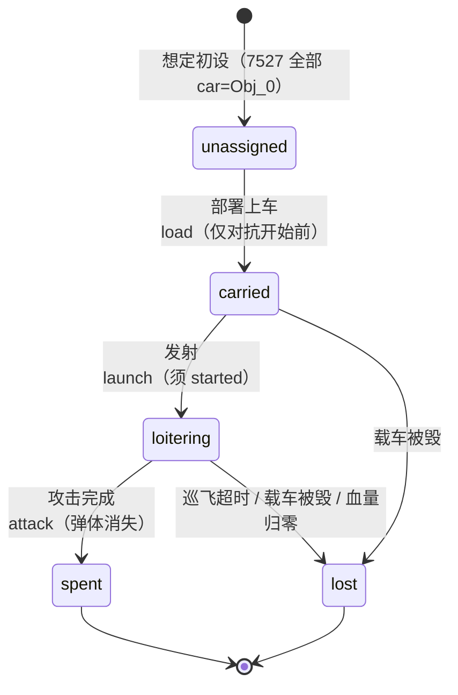

# 巡飞弹生命周期（手册 4.10）

> 对应 issue：**修复巡飞弹生命周期：发射动作缺失、车内状态误判、并发锁及攻击后消耗**。
> 验收脚本 `tools/verify_missile_lifecycle.py`（T1–T9）、回归测试
> `tests/test_missile_lifecycle.py`、规则门 `tools/verify_rules_extra.py` 的 4.10 段。

## 1 状态机（显式状态，不做静默推断）

`Game.missile_state(unit)` 是**唯一**的状态判据，取值见 `engine.game.MISSILE_STATES`：

| 状态 | 含义 | 盘上表现 | 依据 |
|---|---|---|---|
| `unassigned` | 在图上、与任何载车**没有**所属关系 | 有阵营、`blood>0`；无 `carrier` / `launcher` | 手册 4.10(3)（须先上车） |
| `carried` | 已在载车内 | `detail["carrier"]` 指向载车；`blood=0`、`color=""`、编制留在 `establishment` | 平台装卸实测（`docs/运输机制实测.md`） |
| `loitering` | 已发射、在飞 | `detail["launcher"]`；阵营已恢复；在图上、可机动/可攻击 | 手册 4.10(4) |
| `spent` | 已完成一次攻击并消耗（弹体消失） | `blood=0`、`detail["consumed"]=True` | **负责人 2026-10-16 确认：攻击后巡飞弹消失** |
| `lost` | 已损失 | `blood=0` | 手册 4.10(5)（超时自毁 / 载车被毁） |



**判据顺序很关键**：先看载车、再看血量 —— 车内记录 `blood=0` 是“车内读不到兵力”，
不是“已损失”（装卸上已经踩过一次这个坑）。所以 `carrier` + `blood=0` 仍判 `carried`。

## 2 转换与守卫（`engine/game.py`）

| 转换 | 实现 | 拒绝条件 |
|---|---|---|
| `unassigned → carried` | `Game.deploy_missile()`（纯前置条件 `Game.missile_deploy_block()`） | 非巡飞弹 / 状态非 `unassigned` / 未 `started` / **`second != 0`** / 载车非车辆或已毁 / 阵营不同 / 不同格 / 任一方被压制 |
| `carried → loitering` | `Game.launch_missile()` | 非巡飞弹 / 未 `started` / 状态是 `spent`·`lost`（**不复活**）/ 不是 `carried` / 载车对不上或已毁 / **该车已有在飞弹** |
| `loitering → spent` | `Game._consume_missile()`（只由**已执行**的 `attack()` 调用） | —— |
| `loitering → lost` | `Game._terminate_missile()`（`_expire_missiles` / 血量归零） | —— |
| `carried → lost` | `_update_dependencies()`：载车被毁 ⇒ 车内弹一并损失 | —— |

**并发约束是“同一载车同时一枚”，不是“一局一枚”**：占用由
`Game.in_flight_missile(carrier)` 判定（纯查询），弹一被消耗 / 自毁 / 载车被毁就由
`release_launcher()` 释放；之后该车可以再发射**另一枚**车上的合法可用弹（不凭空补弹）。

**保留的原始字段（证据，不参与裁决）**：

| 字段 | 来源 | 说明 |
|---|---|---|
| `detail["car"]` | 单位数据 `car` | 仅在**非空且非 `Obj_0`** 时留存；7527 初态全是 `Obj_0` ⇒ 不写、**不推断** |
| `detail["stop"]` | 单位数据 `stop` | 载车的“在飞占用”标志；发射置 1、释放归 0 |
| `detail["launch_second"]` | 引擎时钟 | 发射时的推演秒 |
| `detail["launch_radar"]` | 单位数据 `radar` | 客户端用它算巡飞计时的毫秒时间戳，原样留存 |
| `detail["loiter_seconds"]` / `loiter_seconds_source` | 实例配置 | 巡飞上限及其**取值来源**（见下） |

## 3 训练接口（`env/`）

| 动作 | 载荷 | 说明 |
|---|---|---|
| `{"type": "load", "unit": <弹>, "carrier": <车>}` | 弹 = 主体 | 人员与巡飞弹走**同一条**上车路径（平台是同一个 `com/ObjInto.asp`）。弹只接受 `unassigned` |
| `{"type": "launch", "unit": <车>, "missile": <弹>}` | 车 = 主体 | 平台侧也是“载车在发射”（客户端读载车 `stop`） |
| `{"type": "unload", "unit": <车>}` | 车 = 主体 | 下车**只卸人员与无人车**；巡飞弹留在车上（客户端「全员下车」只发 `off=1`/`off=2`，`off=3` 走 `com/Obj2_Out.asp` + `CommandOff` = **发射**命令）⇒ 弹离开载车只有 `launch` 一条路，**没有**“把弹取回”这个动作 |

- **动作生成**：`HexwarEnv.legal_actions()` 会为「`unassigned` 且同格有己方车辆」的弹生成 `load`，
  为「车上有弹且当前没有在飞弹」的车生成 `launch`。`load` 走廉价只读判定
  （`_load_gate()` 与引擎的 `missile_deploy_block()` **共用同一口径**，不会漂移）；
  `launch` 走事务校验。真实想定上快速/参考枚举仍 0 分歧（`tools/hex_env_diff.py`）。
- **观测**：己方弹的视图带 `missile_state` / `loiter_seconds_left`，载车视图带
  `missile_in_flight`；车内记录**不下发**（平台同款），只能通过载车的 `carrying` 看到弹的 id。
- **实时层**（`env/realtime_api.py`）：`launch` 的耗时同时占住**载车**与**弹**
  （上车那一秒不能同秒发射）；`RealtimeEpisode._enumerate` 的投影会保留**己方车内单位**
  （`own_units_for_projection()`），否则「发射」永远生成不出来。
- **发起失败的时间代价**：非法 `launch` 在 `TwoPlayerEpisode` 里同样按 `LAUNCH_SEC` 记账
  （与其它动作一致，避免用失败探测隐藏状态）。

## 4 巡飞上限与时钟（未确证项，已显式标注）

手册 4.10(5) 只说“超时自毁”，**没有给数值**。平台侧有代码级证据
（`offline/assets/war.min.js`）：

```js
FlyTime = parseInt(1200 / RoomSpeed);
if (Time1 && e) if (-1 == g.attr("space"))                    // space == -1 即“在飞的弹”
    e = FlyTime - (c = parseInt((new Date(ServerTime) - new Date(e)) / 1E3)),
    c >= FlyTime ? (CommandKill(a),                           // 超时销毁
                    f = $("#" + g.attr("car")),               // 用弹的 car 找载车
                    f.attr("stop", 0))                        // 释放载车占用
```

所以本引擎按 `Game.loiter_seconds(room_speed) = max(1, 1200 // room_speed)`
取默认上限（`RoomSpeed=3` → **400 秒**；练习服/比赛服实测 `RoomSpeed=3`），
并允许 `Game(loiter_sec=...)` 显式覆盖：

```python
g = Game(room_speed=3)          # 400 秒，来源 "client:parseInt(1200/RoomSpeed)"
g = Game(loiter_sec=77)         # 77 秒，来源 "explicit override"
```

⚠️ **仍未确证**：真实发射后服务端下发的 `radar`/`car` 取值，以及
`room_speed` ↔ `RoomSecond` ↔ 训练秒的换算（已知先例是「房间时长 × RoomSpeed」：
`KeepSec 50 × RoomSpeed 3 = SUPPRESS_SEC 150`，与 `FlyTime` 的除法方向相反）。
⇒ 因此取值与来源逐弹记录，且**不**声称已与平台对账；早先的 `LOITER_SEC=120`
是无来源占位值，已降级为对照常量 `LOITER_SEC_PLACEHOLDER`。

其它占位/解释项：

- `LOAD_SEC = 30`（部署耗时，与人员上下车共用）与 `LAUNCH_SEC = 10`（发射耗时）
  都是**占位值**：手册与平台均未给出，代码里明确标注，规则效果不依赖这两个数。
- **“对抗开始前上车”的两个窗口**（`engine.game.DEPLOY_WINDOWS`，环境构造参数同名）：

  | 取值 | 语义 | 用途 |
  |---|---|---|
  | `"opening"`（默认） | 只接受 `second == 0`（本环境里克代表“对抗开始前”的时刻） | 忠实手册 4.10(3) |
  | `"any"` | 只要该弹**尚未发射**（仍 `unassigned`）就允许部署 | 训练/评估里要学到用弹时显式传 |

  ```python
  HexwarEnv(deploy_window="any")            # 或 Game(deploy_window="any")
  TwoPlayerEpisode(path, deploy_window="any")   # RealtimeEpisode 同理
  ```

  ★ **若初设本身就是“已部署上车”**（数据里写 `car=<载具ID>`，见 `link_declared_carriers()`），
  则两个窗口都用不到 —— 第 0 秒即可直接 `launch`。本仓库当前发布的初设是
  **“36 单位全在场、`car=Obj_0`、`sons=0`”**（证据 `2p_before_start.json` / `2p_after_start.json`，
  断言写在 `scenario/7527/manifest.json` 的 `opening_state`），所以默认情形下需要先部署。

## 5 计分影响

7527 的巡飞弹 `score = 0`（`docs/计分规则待确认.md`），因此**消耗/损失对三项分值均无影响**；
`engine/scoring.py` 无需为它加特例。若将来出现 `score > 0` 的巡飞弹，
“攻击后消失”会按普通损失参与 `remaining` / `killed`（对称互补），
届时应先采实测样本再决定是否排除。

## 6 验证入口

```powershell
py -3.13 tools/verify_missile_lifecycle.py      # T1–T9，逐条对应 issue 的验收清单
py -3.13 tools/verify_rules_extra.py            # 规则门里的 4.10 段（37/37）
py -3.13 -m pytest tests/test_missile_lifecycle.py -q
py -3.13 tools/hex_env_diff.py --snapshot scenario/7527 --radius 3   # 枚举等价（0 分歧）
```
